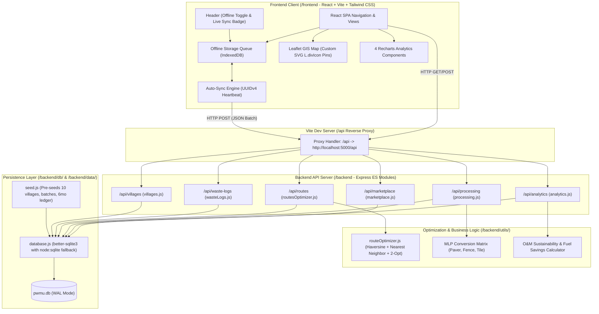
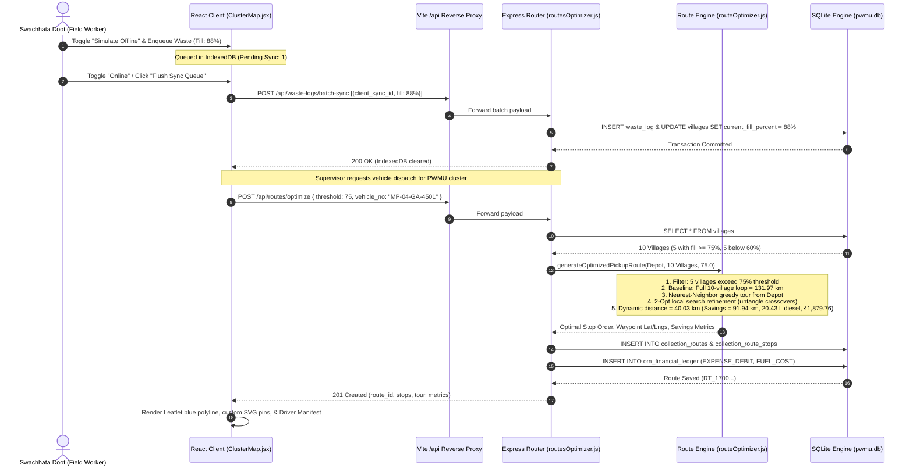

# GramChakra: Technical Report & Presentation Guide
**System Title:** Technical Solutions for Multi-Layer Plastic (MLP) Management at PWMU/MRF Level (SBM-G Rural Solid Waste Management)  
**Academic Project / SIH Assignment Guide**  
**Repository Working Directory:** `gramchakra-mlp-swm`

---

## 1. Complete ASCII Directory Structure
*(Excludes `node_modules/`, lockfiles, and ephemeral build artifacts)*

```text
gramchakra-mlp-swm/
│
├── package.json                         # Root orchestration & convenience scripts
├── start_gramchakra.bat                 # 1-Click launcher for Windows demonstration
├── REPORT_AND_PPT_GUIDE.md              # Academic documentation, API spec & PPT guide
├── EXTRACTED_FULL_CODE.md               # Complete source code export for report submission
│
├── report_screenshots/                  # High-resolution screenshots for report & slides
│   ├── dashboard_4charts.png            # 4-Graph live analytics dashboard
│   ├── offline_sync_queued.png          # 1-Click offline simulation & IndexedDB buffer
│   ├── dynamic_route_map.png            # Leaflet TSP route polyline & fuel/CO2 savings
│   ├── pwmu_batch_conversion.png        # MLP batch processing wizard & stockpile gauge
│   └── contractor_marketplace.png       # Buyer order catalog & financial credit ledger
│
├── backend/                             # Express.js REST API & Routing Engine
│   ├── package.json                     # Backend dependencies (express, cors, better-sqlite3)
│   ├── server.js                        # Gateway entry point, middleware, router mount
│   ├── data/
│   │   └── pwmu.db                      # Local SQLite database (WAL mode, ACID compliant)
│   ├── db/
│   │   ├── database.js                  # Windows-safe SQLite adapter (better-sqlite3 / node:sqlite)
│   │   └── seed.js                      # SBM-G cluster seeder (1 depot, 10 villages, 6mo ledger)
│   ├── routes/
│   │   ├── analytics.js                 # Powers the 4 Recharts visual analytics endpoints
│   │   ├── marketplace.js               # Forward linkages buyer catalog & order ledger
│   │   ├── processing.js                # PWMU composite conversion (pavers, posts, tiles)
│   │   ├── routesOptimizer.js           # Dynamic TSP pickup dispatch & savings calculator
│   │   ├── villages.js                  # Village metadata, GPS coordinates & shed fill levels
│   │   └── wasteLogs.js                 # 4-stream logging, offline sync & UUID deduplication
│   ├── test/
│   │   └── routeTest.js                 # Automated test suite (Haversine, 2-Opt, Fuel math)
│   └── utils/
│       └── routeOptimizer.js            # Algorithmic engine (Haversine + Nearest-Neighbor + 2-Opt)
│
└── frontend/                            # React + Vite + Tailwind CSS Client
    ├── index.html                       # HTML5 entry with Leaflet stylesheet & typography
    ├── package.json                     # Client dependencies (lucide, leaflet, recharts)
    ├── postcss.config.js                # PostCSS Tailwind plugin configuration
    ├── tailwind.config.js               # Tailwind design system & color tokens
    ├── vite.config.js                   # Vite dev server with reverse proxy (/api -> :5000)
    └── src/
        ├── App.jsx                      # App root, tab router, offline state coordinator
        ├── index.css                    # Tailwind directives, custom pulsing SVG markers
        ├── main.jsx                     # React DOM root render
        ├── components/
        │   ├── Header.jsx               # Header with 1-click Offline toggle & sync badge
        │   ├── ClusterMap.jsx           # Leaflet GIS cluster map with custom SVG pins
        │   ├── charts/
        │   │   ├── FinancialLedgerChart.jsx # Graph 3: 6-Mo Revenue vs Expense Composed Chart
        │   │   ├── ProductInventoryChart.jsx# Graph 4: Upcycled Stock Horizontal Bar Chart
        │   │   ├── StreamBreakdownChart.jsx # Graph 1: 4-Stream Waste Segregation Donut Chart
        │   │   └── VillageFillChart.jsx     # Graph 2: Shed Capacities with 75% Threshold Line
        │   └── views/
        │       ├── DashboardView.jsx    # Executive overview cards & 4-graph analytics grid
        │       ├── MarketplaceView.jsx  # Contractor procurement order catalog & history
        │       ├── PWMUProcessingView.jsx# Upcycling batch calculator & raw stockpile gauge
        │       └── WasteLoggerView.jsx  # Touch-friendly 4-stream mobile field logger
        └── utils/
            └── offlineQueue.js          # Browser IndexedDB queue manager & sync worker
```

---

## 2. Visual Architecture Diagrams (Verified Against Built Code)

### 2.1 System Architecture Diagram


---

### 2.2 Complete 9-Table Database Entity-Relationship (ER) Diagram

```mermaid
erDiagram
    VILLAGES ||--o{ WASTE_LOGS : "generates"
    VILLAGES ||--o{ COLLECTION_ROUTE_STOPS : "included_in"
    COLLECTION_ROUTES ||--o{ COLLECTION_ROUTE_STOPS : "contains"
    PROCESSING_BATCHES ||--o{ FINISHED_PRODUCTS : "updates_stock"
    FINISHED_PRODUCTS ||--o{ ORDER_ITEMS : "ordered_as"
    BUYER_ORDERS ||--o{ ORDER_ITEMS : "contains"
    BUYER_ORDERS }o--|| OM_FINANCIAL_LEDGER : "credits_revenue"
    COLLECTION_ROUTES }o--|| OM_FINANCIAL_LEDGER : "debits_fuel"

    VILLAGES {
        string id PK "Unique village code (e.g. VIL_01)"
        string name "Village name"
        string panchayat_name "Gram Panchayat administrative entity"
        string block_name "Block / Taluka name (e.g. Phanda Block)"
        float latitude "GPS Latitude coordinate"
        float longitude "GPS Longitude coordinate"
        float current_fill_percent "Real-time aggregate shed fill %"
        string last_updated_at "Timestamp of last fill update"
    }

    WASTE_LOGS {
        string id PK "Primary key"
        string client_sync_id UK "Idempotent UUID generated by client"
        string village_id FK "References VILLAGES.id"
        float wet_waste_kg "Wet organic waste weight"
        float dry_recyclable_kg "Dry recyclables (PET, glass, cans)"
        float mlp_waste_kg "Multi-Layer Plastic laminates weight"
        float sanitary_hazardous_kg "Sanitary and domestic hazardous weight"
        float recorded_fill_percent "Shed fill level at logging time"
        string logged_by "Name / ID of Swachhata Doot"
        string recorded_at "Client capture timestamp"
        string synced_at "Server receipt timestamp"
    }

    COLLECTION_ROUTES {
        string id PK "Route ID (e.g. RT_1700000000)"
        string route_date "Dispatch execution date"
        string status "OPTIMIZED, DISPATCHED, COMPLETED"
        float threshold_filter_percent "Threshold used (default: 75.0%)"
        float total_distance_km "Optimized dynamic route length"
        float estimated_fuel_liters "Fuel consumed (at 4.5 km/L)"
        float estimated_fuel_cost_inr "Fuel cost in INR (at 92 INR/L)"
        float baseline_static_distance_km "All-village baseline distance"
        float fuel_savings_inr "INR saved vs fixed schedule"
        float co2_savings_kg "Carbon avoided (2.68 kg CO2/L)"
        string dispatched_vehicle_no "Vehicle registration"
        string created_at "Generation timestamp"
    }

    COLLECTION_ROUTE_STOPS {
        string id PK "Stop primary key"
        string route_id FK "References COLLECTION_ROUTES.id"
        string village_id FK "References VILLAGES.id"
        int stop_sequence "Itinerary stop sequence (1, 2, 3...)"
        float village_fill_at_dispatch "Shed fill % at optimization time"
        string collection_status "PENDING, COLLECTED, SKIPPED"
    }

    PROCESSING_BATCHES {
        string id PK "Batch primary key"
        string batch_code UK "Human-readable code (e.g. BATCH-2026-PA233)"
        string product_type "PAVER_BLOCK, FENCING_POST, ROOF_TILE"
        float mlp_input_kg "Raw shredded MLP weight consumed"
        float aggregate_input_kg "Sand / stone dust / fly ash consumed"
        int units_produced "Finished product units manufactured"
        float electricity_kwh "Energy consumed"
        float labor_cost_inr "Operator wages for run"
        string batch_date "Date of production"
        string status "IN_PROGRESS, COMPLETED"
    }

    FINISHED_PRODUCTS {
        string id PK "Product identifier (e.g. PROD_PAVER)"
        string product_type "PAVER_BLOCK, FENCING_POST, ROOF_TILE"
        string unit_name "Unit of measurement (Piece, Post, Tile)"
        int stock_units "Current ready stock in warehouse"
        float unit_price_inr "Procurement price per unit"
        int min_order_units "Minimum order quantity"
        string updated_at "Last inventory adjustment timestamp"
    }

    BUYER_ORDERS {
        string id PK "Order primary key"
        string order_number UK "Invoice / Order code (e.g. ORD-2026-4920)"
        string buyer_name "Panchayat / Contractor name"
        string buyer_type "GRAM_PANCHAYAT, PWD_CONTRACTOR, PRIVATE_FARMER"
        string contact_phone "Contact number"
        string delivery_address "Delivery village / road site location"
        float total_amount_inr "Total invoice value"
        string payment_status "PENDING, PAID, PARTIAL"
        string fulfillment_status "ORDERED, DISPATCHED, DELIVERED"
        string order_date "Order creation date"
    }

    ORDER_ITEMS {
        string id PK "Order item primary key"
        string order_id FK "References BUYER_ORDERS.id"
        string product_id FK "References FINISHED_PRODUCTS.id"
        int quantity "Units ordered"
        float unit_price_inr "Unit price charged"
        float subtotal_inr "Line item subtotal"
    }

    OM_FINANCIAL_LEDGER {
        string id PK "Ledger primary key"
        string entry_date "Transaction date"
        string entry_type "REVENUE_CREDIT, EXPENSE_DEBIT"
        string category "PRODUCT_SALES, RECYCLABLES_SCRAP, FUEL_COST, OPERATOR_WAGES, ELECTRICITY"
        float amount_inr "Transaction value in INR"
        string reference_id "Related route_id, order_id, or batch_code"
        string description "Accounting line item description"
    }
```


---

### 2.3 Dynamic Route Optimization API Sequence Diagram


---

## 3. Complete REST API Specification Table

| Endpoint URL | HTTP Method | Request Payload / Query Params | Response JSON Structure | Purpose |
| :--- | :---: | :--- | :--- | :--- |
| `/api/health` | `GET` | None | `{"status":"ONLINE","system":"GramChakra SBM-G...","timestamp":"..."}` | Service health & uptime probe |
| `/api/villages` | `GET` | None | `{"success":true,"count":10,"data":[{id, name, latitude, longitude, current_fill_percent}]}` | Fetch all rural collection sheds & fill % |
| `/api/villages/depot` | `GET` | None | `{"success":true,"data":{id:"DEPOT_00", name:"Central PWMU Depot", latitude:23.2599, longitude:77.4126}}` | Fetch central processing depot location |
| `/api/villages/:id/fill` | `PATCH` | `{"fill_percent": 88}` | `{"success":true,"message":"Updated Rampur Kalan shed...","data":{...}}` | Update shed fill level directly |
| `/api/waste-logs` | `POST` | `{"client_sync_id": "UUID", "village_id": "VIL_01", "wet_waste_kg": 40, "dry_recyclable_kg": 25, "mlp_waste_kg": 20, "sanitary_hazardous_kg": 5, "recorded_fill_percent": 85}` | `{"success":true,"message":"Waste log recorded","data":{id, client_sync_id, ...}}` | Log 4-stream entry (idempotent via UUID) |
| `/api/waste-logs/batch-sync`| `POST` | `{"items": [{client_sync_id, village_id, wet_waste_kg, ...}]}` | `{"success":true,"message":"Successfully flushed and synced 3 logs","count":3,"data":[...]}` | Flush client IndexedDB offline queue |
| `/api/waste-logs` | `GET` | None | `{"success":true,"count":50,"data":[{id, village_name, wet_waste_kg, ...}]}` | List 50 most recent waste collection logs |
| `/api/waste-logs/summary` | `GET` | None | `{"success":true,"data":{total_wet_kg, total_dry_kg, total_mlp_kg, total_sanitary_kg, total_waste_kg}}` | Aggregate stream weights across all logs |
| `/api/routes/optimize` | `POST` | `{"threshold": 75.0, "vehicle_no": "MP-04-GA-4501"}` | `{"success":true,"action_required":true,"route_id":"RT_...","data":{stops, tour, metrics}}` | Compute dynamic TSP route & fuel savings |
| `/api/routes` | `GET` | None | `{"success":true,"count":20,"data":[{id, route_date, total_distance_km, fuel_savings_inr}]}` | Historical vehicle dispatch runs |
| `/api/routes/latest` | `GET` | None | `{"success":true,"data":{id, route_date, stops, tour, total_distance_km, fuel_savings_inr}}` | Fetch most recent active route with stops |
| `/api/routes/:id/manifest` | `GET` | `:id` (route ID) | `{"success":true,"manifest":{route_id, date, vehicle, total_distance, itinerary:[...]}}` | Exportable driver turn-by-turn manifest |
| `/api/processing/stockpile`| `GET` | None | `{"success":true,"data":{total_collected_mlp_kg, total_consumed_mlp_kg, available_stockpile_kg}}` | Live shredded MLP inventory balance |
| `/api/processing/batches` | `GET` | None | `{"success":true,"count":5,"data":[{id, batch_code, product_type, mlp_input_kg, units_produced}]}` | History of upcycling production runs |
| `/api/processing/batches` | `POST` | `{"product_type":"PAVER_BLOCK","mlp_input_kg":200,"electricity_kwh":90,"labor_cost_inr":1800}` | `{"success":true,"message":"Batch completed...","data":{batch, current_product_stock}}` | Convert MLP into products & update stock |
| `/api/processing/products` | `GET` | None | `{"success":true,"data":[{id, product_type, stock_units, unit_price_inr}]}` | Warehouse inventory of circular products |
| `/api/marketplace/products`| `GET` | None | `{"success":true,"count":3,"data":[{id, product_type, unit_name, stock_units, unit_price_inr}]}` | Product catalog for Panchayat buyers |
| `/api/marketplace/orders` | `GET` | None | `{"success":true,"count":4,"data":[{id, order_number, buyer_name, total_amount_inr, items:[...]}]}` | Purchase orders with line items |
| `/api/marketplace/orders` | `POST` | `{"buyer_name":"Rampur GP","buyer_type":"GRAM_PANCHAYAT","contact_phone":"98260...","items":[{"product_id":"PROD_PAVER","quantity":100}]}` | `{"success":true,"message":"Order placed successfully!","data":{order_id, order_number, total_amount_inr}}` | Place procurement order & credit ledger |
| `/api/analytics/stream-breakdown` | `GET` | None | `{"success":true,"total_kg":24061,"data":[{"name":"Wet Waste","value":11242,"fill":"#10B981"},...]}` | Powers Graph 1 (Donut Chart) |
| `/api/analytics/village-fills` | `GET` | None | `{"success":true,"threshold":75.0,"critical_count":5,"data":[{"name":"Shivgarh","fill_percent":92},...]}` | Powers Graph 2 (Bar Chart + 75% Line) |
| `/api/analytics/monthly-financials`| `GET` | None | `{"success":true,"months_count":6,"data":[{"month":"2026-11","revenue_inr":115600,"expenses_inr":47600,"net_margin_inr":68000}]}` | Powers Graph 3 (Composed Chart) |
| `/api/analytics/product-inventory` | `GET` | None | `{"success":true,"data":[{"displayName":"Paver Blocks","stock_units":2350,"inventory_value_inr":105750}]}` | Powers Graph 4 (Horizontal Bar Chart) |
| `/api/analytics/kpis` | `GET` | None | `{"success":true,"data":{total_waste_collected_kg, total_mlp_diverted_kg, total_fuel_savings_inr, cost_recovery_percent}}` | Executive KPI overview cards |

---

## 4. Report-Ready Technical Deep-Dives

### 4.1 Route Optimization Mathematics & Rural O&M Economics
Dynamic route optimization eliminates the principal financial leak in rural SBM-G programs: fixed-schedule vehicle runs to half-empty collection sheds.

1. **Haversine Geodesic Distance Formula:**  
   $$\Delta \phi = \text{lat}_2 - \text{lat}_1, \quad \Delta \lambda = \text{lon}_2 - \text{lon}_1$$  
   $$a = \sin^2\left(\frac{\Delta \phi}{2}\right) + \cos(\phi_1)\cos(\phi_2)\sin^2\left(\frac{\Delta \lambda}{2}\right)$$  
   $$c = 2 \cdot \text{atan2}\left(\sqrt{a}, \sqrt{1 - a}\right), \quad d = R \cdot c \quad (R = 6,371.0 \text{ km})$$
2. **Demand-Gated Threshold Filter:**  
   $$V_{\text{eligible}} = \{ v \in V_{\text{cluster}} \mid \text{fill}(v) \ge \theta_{\text{threshold}} \} \quad (\theta = 75\%)$$
3. **Nearest-Neighbor Tour Construction:**  
   Greedily appends the closest unvisited eligible village from the current node starting at the Central PWMU Depot and returning to it.
4. **2-Opt Local Search Heuristic:**  
   Iteratively evaluates edge pairs $(u, v)$ and $(x, y)$. If reversing the sub-tour eliminates intersecting paths such that $\text{dist}(u, x) + \text{dist}(v, y) < \text{dist}(u, v) + \text{dist}(x, y)$, the reversal is committed.
5. **Verified Empirical Results:**
   - **Baseline Static Loop (All 10 Villages):** $131.97 \text{ km}$ ($29.33 \text{ L diesel}$, ₹$2,698.36$).
   - **Dynamic Route (5 Critical Villages $\ge 75\%$):** $40.03 \text{ km}$ ($8.90 \text{ L diesel}$, ₹$818.80$).
   - **Resource Savings per Dispatch:**  
     $$\Delta \text{ Distance} = \mathbf{91.94 \text{ km (69.7\% reduction)}}$$  
     $$\Delta \text{ Fuel} = \mathbf{20.43 \text{ Liters}}$$  
     $$\Delta \text{ Cost} = \mathbf{₹1,879.76 \text{ saved}}$$  
     $$\Delta \text{ Carbon} = 20.43 \times 2.68 = \mathbf{54.76 \text{ kg CO}_2 \text{ avoided}}$$

---

### 4.2 Offline-First Architecture & Idempotent UUID Synchronization
To address zero-connectivity edge sheds in rural areas:
1. **Client-Side Buffered Persistence:**  
   Submissions are intercepted when offline (detected via `navigator.onLine` or the "Simulate Offline" switch) and stored in browser **IndexedDB** (`gramchakra_offline_db` $\rightarrow$ `waste_logs_queue`).
2. **Idempotent Client-Generated UUIDs:**  
   Every entry receives an RFC-4122 compliant `client_sync_id` (UUIDv4).
3. **Atomic Reconnection Reconciliation:**  
   When connectivity returns, an auto-sync worker calls `POST /api/waste-logs/batch-sync`.
4. **Deduplication Logic:**  
   The backend wraps insertions in an atomic SQLite transaction. If a `client_sync_id` already exists, the server returns HTTP 200 without duplicating the weight record or corrupting village fill levels.

---

### 4.3 Interactive Recharts Visual Analytics Architecture
The 4 live Recharts components map directly to operational pillars:

| Component | Chart Type | API Endpoint | SBM-G Operational Insight |
| :--- | :--- | :--- | :--- |
| **`StreamBreakdownChart.jsx`** | Donut / Pie Chart | `/api/analytics/stream-breakdown` | Tracks compliance with 4-stream source segregation; quantifies non-recyclable MLP available for PWMU processing. |
| **`VillageFillChart.jsx`** | Vertical Bar Chart | `/api/analytics/village-fills` | Highlights shed fill levels across 10 villages against the red dashed **75% Pickup Trigger** `ReferenceLine`. |
| **`FinancialLedgerChart.jsx`** | Composed Bar + Line | `/api/analytics/monthly-financials` | Tracks 6 months of O&M cost recovery; proves that paver/post sales offset vehicle fuel and operator wages. |
| **`ProductInventoryChart.jsx`**| Horizontal Bar Chart | `/api/analytics/product-inventory` | Displays warehouse stock and valuation for Paver Blocks, Fencing Posts, and Roof Tiles ready for Panchayat orders. |

---

## 5. Ready-to-Use 10-Slide Presentation Outline

### Slide 1: Title & Overview
- **Header:** GramChakra: Technical Solutions for Rural Multi-Layer Plastic (MLP) Management
- **Sub-header:** SBM-G Phase II Solid Waste Management & Dynamic Vehicle Logistics
- **Key Points:**
  - Addresses rural plastic pollution and PWMU operational failure.
  - Combines IoT/mobile 4-stream tracking, graph optimization, and circular economy.
  - Full-stack production implementation with offline-first architecture.

### Slide 2: Rural Problem Statement & The O&M Crisis
- **Header:** Why Rural SBM-G Solid Waste Programs Stall
- **Key Points:**
  - **Fuel O&M Bleed:** Emptying sheds on fixed schedules wastes 40–60% of Gram Panchayat fuel budgets.
  - **Connectivity Void:** Rural *Swachhata Doots* work in 2G/spotty signal environments.
  - **MLP Dead-End:** Metallized multi-layer packaging has zero scrap value and ends up burned or buried.
  - **Grant Dependency:** Lack of local revenue creates operational failure once grants expire.

### Slide 3: System Architecture & Tech Stack
- **Header:** Architecture Designed for Rural Constraints
- **Key Points:**
  - **Frontend:** React + Vite + Tailwind CSS + Lucide Icons + Leaflet (OpenStreetMap) + Recharts.
  - **Backend:** Node.js + Express (ES Modules) with reverse proxy eliminating CORS.
  - **Database:** Zero-config Windows-safe SQLite (`better-sqlite3` WAL mode with `node:sqlite` fallback).
  - **Field Sync:** Browser IndexedDB offline queue with client-side UUID idempotency.

### Slide 4: 4-Stream Source Segregation & 1-Click Offline Sync
- **Header:** Low-Bandwidth Data Collection at Village Aggregation Sheds
- **Key Points:**
  - Tracks 4 streams: Wet (Organic), Dry Recyclable, MLP (Laminates), Sanitary/Hazardous.
  - Field workers log shed fill levels and weights on touch-friendly mobile forms.
  - "Simulate Offline Mode" toggle enables demonstration of zero data loss under network failure.
  - Automatic batch reconciliation flushes queued records upon reconnection.

### Slide 5: Demand-Based Dynamic Route Optimization
- **Header:** Cutting Fuel Costs via Threshold-Gated Graph Optimization
- **Key Points:**
  - **75% Fill Gate:** Only sheds breaching capacity trigger vehicle dispatch.
  - **Algorithms:** Haversine geodesic distance matrix $\rightarrow$ Greedy Nearest-Neighbor $\rightarrow$ 2-Opt edge untangling.
  - **Verified Output:** 91.94 km saved, 20.43 L diesel saved, ₹1,879.76 saved per pickup run.
  - **Environmental Dividend:** 54.76 kg CO₂ emissions avoided per dispatch.

### Slide 6: GIS Mapping & Driver Dispatch Manifest
- **Header:** Interactive OpenStreetMap GIS with Custom SVG Markers
- **Key Points:**
  - Leaflet map eliminates broken PNG pins using dynamic `L.divIcon` SVG markers.
  - Color-coded pins: Red pulsing (≥75% critical), Amber (50–74%), Green (<50%), Blue (PWMU Depot).
  - Polyline overlay displays the exact optimized closed-loop route from depot to sheds.
  - Generates a turn-by-turn dispatch itinerary and printable manifest for vehicle drivers.

### Slide 7: PWMU Batch Conversion & MLP Upcycling
- **Header:** Transforming Zero-Value Plastic into Durable Infrastructure
- **Key Points:**
  - Agglomeration and compression molding of shredded MLP + mineral aggregates.
  - **Conversion Ratios:**
    - Heavy-Duty Paver Blocks: 1 kg MLP + 3 kg Sand $\rightarrow$ 3 Blocks (₹45/unit).
    - 6ft Fencing Posts: 4 kg MLP + 8 kg Mineral Aggregate $\rightarrow$ 1 Post (₹320/unit).
    - Interlocking Roof Tiles: 1.5 kg MLP + 2.5 kg Fly Ash $\rightarrow$ 1 Tile (₹180/unit).
  - Real-time stockpile gauge auto-deducts input kg and credits finished stock.

### Slide 8: Forward Linkages & Contractor Marketplace
- **Header:** Self-Sustaining Gram Panchayat Revenue Model
- **Key Points:**
  - Direct procurement portal for Gram Panchayats (MGNREGA roads) and PWD contractors.
  - Placing an order validates stock, generates invoice, and decrements warehouse inventory.
  - 100% of purchase revenue is credited to the `OM_FINANCIAL_LEDGER`.
  - Replaces erratic government subsidies with internal circular economy cash flows.

### Slide 9: Executive Dashboard & Live Financial Ledger
- **Header:** Real-Time O&M Cost Recovery Analytics
- **Key Points:**
  - 4 live Recharts graphs powered by `/api/analytics/*` endpoints.
  - Donut Chart: 4-stream breakdown; Bar Chart: Village shed fill levels with 75% reference line.
  - Composed Chart: 6-month revenues vs. operating debits (fuel, wages, electricity).
  - Cost Recovery Ratio demonstrates operational self-sufficiency without grant dependency.

### Slide 10: Conclusion & National SBM-G Scalability
- **Header:** Scalability, Policy Alignment & Future Roadmap
- **Key Points:**
  - Directly fulfills Swachh Bharat Mission - Gramin Phase II objectives.
  - Portable, zero-infrastructure deployment suitable for block-level computers.
  - Immediate operational savings: 69.7% fuel reduction and self-funding rural infrastructure.
  - Ready for deployment across District Rural Development Agencies (DRDAs) and State SWM missions.
